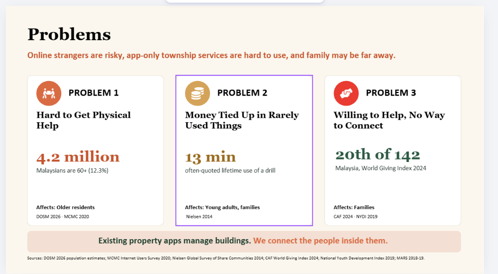
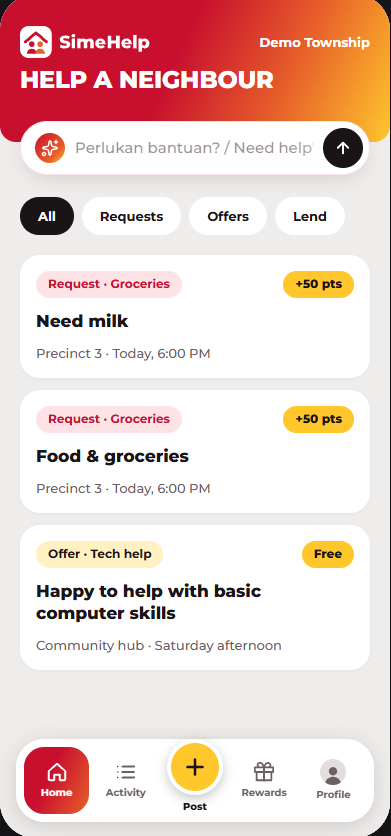

# SimeHelp

> A verified township marketplace where neighbours help each other and earn rewards, built so every resident can take part.

## The Problem
Existing property apps manage buildings, gates, and billing, but fail to connect the people living inside them. Residents often need everyday physical help (with over 4.2 million Malaysians aged 60+ and family members often living far away) and have financial value tied up in rarely used tools (such as power drills with an average lifetime use of just 13 minutes). Despite Malaysians ranking 20th out of 142 globally on the World Giving Index, neighbours have no safe, hyper-local, and verified channel to help one another without exposing personal contact details to online strangers.

*Selected Problem Statement: **Sime Darby Property University Hackathon 2026 — People Track**: "How might we enable every resident to live healthier, safer, more connected and more fulfilling lives?"*

<p align="center">
  
</p>

## Our Solution
**SimeHelp** (developed under working name *Tolong*) is a verified, township-only mutual-aid marketplace that turns neighbours into an active support network. Residents can request practical help (e.g. lift to a local clinic, parcel pickup, OTC medicine), offer skills, or lend household items without any cash transactions. Exchanges are securely validated in person at handover through dynamic, short-lived QR codes, awarding helpers demo township points redeemable for Sime Darby Property mall vouchers, parking privileges, or community tree planting. Meanwhile, township managers gain visibility into community well-being through an operator management dashboard.

<p align="center">
  
</p>

## Key Features
- **Hyper-Local & Privacy-First Feed:** Anonymous, block-level listing cards (no public names, contact numbers, or unit addresses exposed). Personal details are only revealed between matched parties after mutual acceptance.
- **10-Second Task Creation & Templates:** Rapid request, offer, and tool-lending creation with smart presets tailored to township life.
- **In-Person QR Handover Verification:** Anti-fraud handover mechanism using trusted time-limited QR generation and scanner verification before points are credited.
- **Private Task Coordination Chat:** Real-time in-app coordination between accepted participants for seamless, contact-safe handovers.
- **Township Rewards & Fair-Use Points Engine:** Fair points distribution with daily caps, redeemable for fictional township perks, retail vouchers, and sustainability initiatives (e.g. planting a township tree).
- **Inclusive AI Assistant:** "Tolong Assistant" conversational prompt bar that translates natural language requests (Malay & English) into structured marketplace listings for seniors and non-tech-savvy residents.
- **Township Operator Dashboard:** Dedicated management view showing real-time resident activity, category breakdowns, and unmet neighbourhood needs.

## Demo
- **Live link:** [https://team-odyssey-sdp.vercel.app/](https://team-odyssey-sdp.vercel.app/)
- **Video demo:** https://... *(Recording / pitch link)*
- **Slides (if any):** https://... *(Pitch deck link)*

## Tech Stack
- **Frontend:** Next.js 16 (App Router), React 19, TypeScript, Tailwind CSS v4, Lucide React
- **Backend & Database:** Supabase (PostgreSQL, Row Level Security policies, trusted database functions, secure SSR cookie authentication)
- **AI & Integrations:** Natural Language Assistant, Web Crypto API QR verification, HTML5 QR scanner (`html5-qrcode` & `qrcode.react`)
- **Deployment:** Vercel

## How to Run It
1. Clone the repo
   ```bash
   git clone https://github.com/team-odyssey/team-odyssey-sdp.git
   cd team-odyssey-sdp
   ```
2. Install dependencies
   ```bash
   npm install
   ```
3. Add your environment variables (see `.env.example`)
   ```bash
   cp .env.example .env.local
   ```
   Configure your Supabase credentials in `.env.local`:
   ```env
   NEXT_PUBLIC_SUPABASE_URL=your-supabase-project-url
   NEXT_PUBLIC_SUPABASE_ANON_KEY=your-supabase-publishable-key
   ```
4. Run it
   ```bash
   npm run dev
   ```
   Open [http://localhost:3000](http://localhost:3000) in your browser. For a two-resident test, open two distinct browser sessions (or an Incognito window) to simulate the requester and helper flows.

## What's Next
1. **Multi-Channel Inclusion:** Expand the senior inclusion path with voice input and a WhatsApp/SMS conversational bridge for non-smartphone users.
2. **Township Pilot & App Integration:** Pilot the platform in City of Elmina / Bukit Jelutong with resident association seeding, integrating residency verification with the Sime Darby Property App.

## Hackathon
Built for **Township of Tomorrow: Sime Darby Property University Hackathon 2026 (People Track)**, October 2026.
